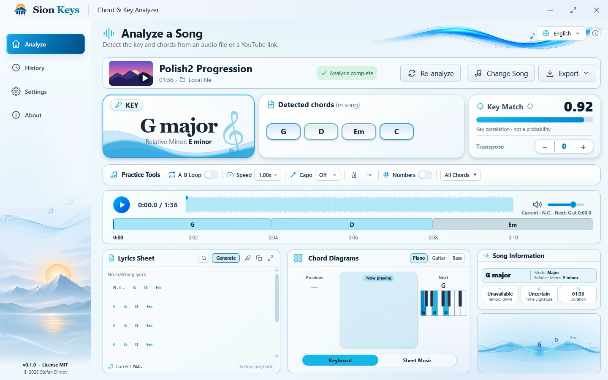
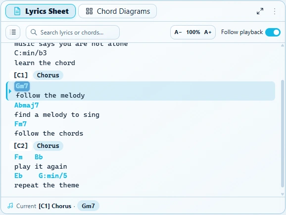
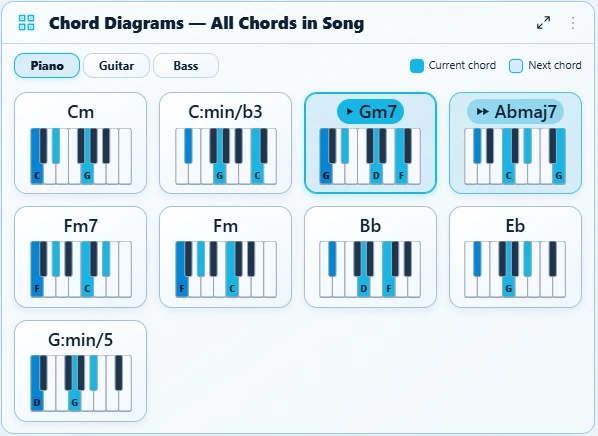
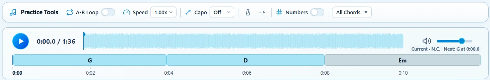
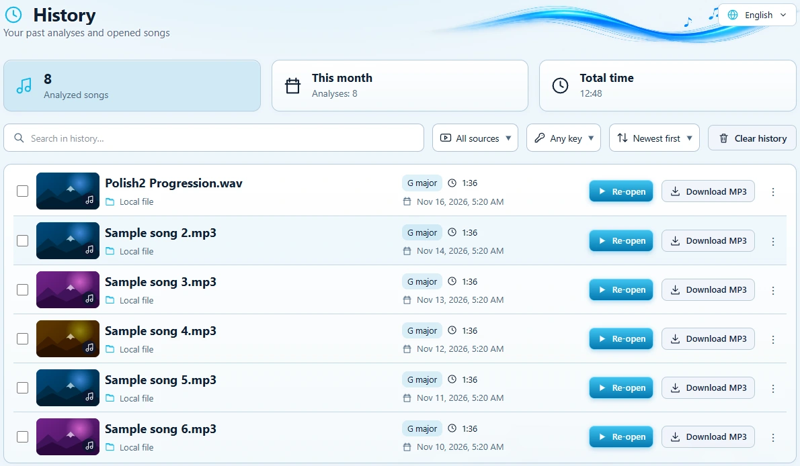
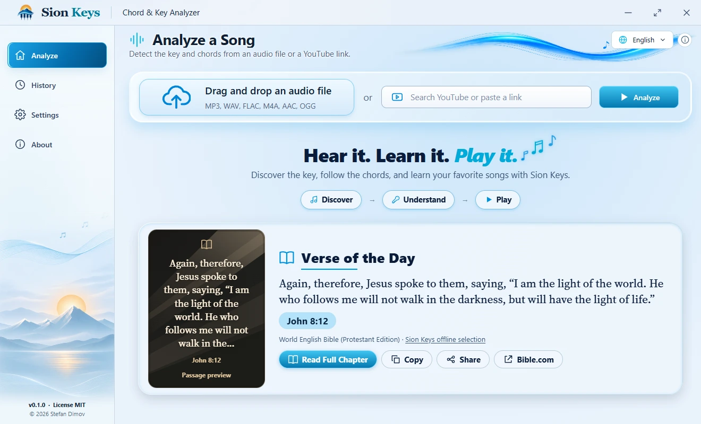
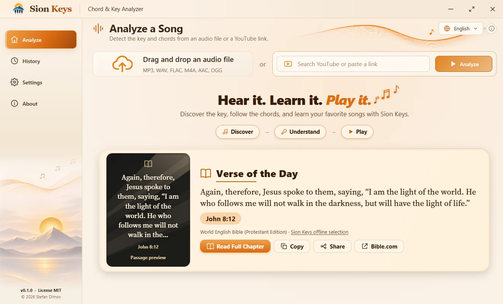
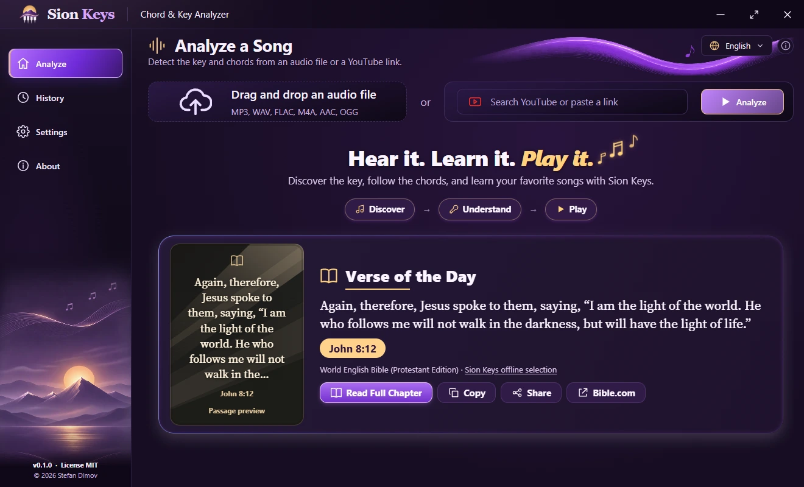
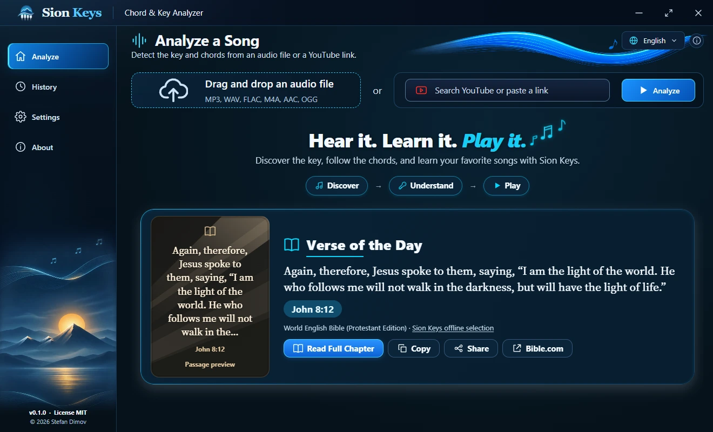

  

<h1 align="center">Sion Keys</h1>

<strong>Chord &amp; Key Analyzer for Musicians, Learners and Worship Teams</strong>

Sion Keys helps you discover the musical key and chords of your favorite songs, follow lyrics with chord annotations, explore interactive chord diagrams and practice at your own pace.

<strong>Windows 10/11</strong> · <strong>Free to Use</strong> · <strong>Automatic Updates</strong> · <strong>Worship-Friendly</strong>

<table width="100%">
  <tr>
    <td align="center" valign="top" width="25%">♫ <strong>Analyze Songs</strong> Find chords and keys from audio files or supported YouTube links.</td>
    <td align="center" valign="top" width="25%">♬ <strong>Lyrics + Chords</strong> Read chord annotations and follow playback when lyrics are synced.</td>
    <td align="center" valign="top" width="25%">♯ <strong>Chord Diagrams</strong> Explore voicings on piano, guitar, and bass.</td>
    <td align="center" valign="top" width="25%">▷ <strong>Practice &amp; Learn</strong> Adjust speed, loop a passage, transpose, or use capo and chord numbers.</td>
  </tr>
</table>

## Analyze a Song

*The standard Analyze layout in the Windows app, shown with a sample progression.*

## Download Sion Keys

**Free for Windows 10 and Windows 11 (64-bit).**

**[⬇ Download for Windows (64-bit)](https://github.com/Stefan7kk/sion-keys-releases/releases/latest)**

The current release is **v0.1.0**. Open **Assets** and choose the Windows setup file (about **191 MiB**). [All releases](https://github.com/Stefan7kk/sion-keys-releases/releases) · [Installation and checksums](INSTALLATION.md) · [Changelog](CHANGELOG.md)

Sion Keys uses Microsoft Edge WebView2. The audio analysis engine ships with the installer. The optional Whisper setup is for local lyric transcription. Windows may show an unknown-publisher prompt for v0.1.0.

## Quick Start

1. Download the latest Windows installer.
2. Install and launch Sion Keys.
3. Open an audio file or use a supported YouTube link.
4. Analyze the song to discover its estimated key and chords.
5. Explore the Lyrics Sheet and chord diagrams.
6. Practice a passage using playback, looping, and speed controls.

## Lyrics Sheet

Read lyrics with chords above the words. **Follow playback** highlights the current line when timing and playable audio are available.

## Chord Diagrams

Switch between **Piano**, **Guitar**, and **Bass**. The diagrams show chord tones or fingerings for the selected instrument. Current and upcoming chords follow your position in the song.

## Practice Tools and Timeline

Set an **A–B loop**, slow down playback, choose a capo position, or transpose the displayed chords. Switch between **All Chords** and **Clean Progression**, and click the timeline to jump to a passage.

## History

Find and reopen past analyses using the search and filters in **History**. Export chord sheets or analysis data from the Analyze page.

## Four Themes

Choose Ice, Warm, Rich, or Dark in **Settings → Appearance**. Select a screenshot to open it at full size.

<table width="100%">
  <tr>
    <td align="center" width="50%"> <strong>Ice</strong></td>
    <td align="center" width="50%"> <strong>Warm</strong></td>
  </tr>
  <tr>
    <td align="center" width="50%"> <strong>Rich</strong></td>
    <td align="center" width="50%"> <strong>Dark</strong></td>
  </tr>
</table>

The interface is available in 23 languages, including right-to-left languages. Use **Settings → Check for Updates** to look for a newer release. Sion Keys verifies the updater signature before installing an update. [Installation and updates](INSTALLATION.md)

## The Story Behind Sion Keys

Sion Keys grew from a love of music, a personal journey of faith and a desire to help others learn the songs they love. Inspired by the joy of worship and the challenge of learning music by ear, the project aims to make exploring chords, musical keys and song arrangements simpler and more accessible.

Read the full story

My name is Stefan Dimov. I began following Jesus after a personal encounter with Him in 2020.

Music has always had a special place in my heart. I love playing the piano and my Korg Pa arranger, but the greatest joy music brings me is the opportunity to worship Jesus and give glory to God.

> *“I am the way, the truth, and the life: no man cometh unto the Father, but by me.”*
>
> [John 14:6, KJV](https://www.bible.com/bible/1/JHN.14.6.KJV)

### Why Sion Keys?

The name **Sion Keys** is inspired by Mount Sion, mentioned in Hebrews 12:22, where Scripture speaks of the city of the living God and the heavenly Jerusalem.

I chose this name because my faith and my love for worship are at the heart of this project. For me, Sion Keys is more than a music application. It is an opportunity to share something useful with others through the gift of music.

[Hebrews 12:22, KJV](https://www.bible.com/bible/1/HEB.12.22.KJV)

### How Sion Keys Began

I learned to play music by ear, and I know how frustrating it can be to hear a beautiful song, want to play it, but struggle to find the right chords.

As I was learning, chord-recognition tools helped me understand songs that I couldn't figure out on my own. That experience gave me an idea: what if there were a simpler, more accessible way for people to discover chords, understand musical keys, and learn the songs they love?

That idea eventually became **Sion Keys**.

My goal was to create a free chord and key analyzer that musicians could use to explore songs, practice, and grow in confidence—whether they're complete beginners, experienced players, or members of a worship team.

### My Hope for Sion Keys

I hope Sion Keys makes learning music a little easier and more enjoyable. I want it to help people spend less time struggling to find chords and more time playing, learning, creating, and sharing music with others.

If this application helps even one person learn a song they love, grow as a musician, or find greater joy in worship, then creating it has been worthwhile.

Above all, I am grateful to God for the opportunity to build something that may encourage and help others.

> *“Christ died for our sins ... and that he was buried, and that he rose again the third day according to the scriptures.”*
>
> [1 Corinthians 15:3–4, KJV](https://www.bible.com/bible/1/1CO.15.3-4.KJV)

> *“I am the resurrection, and the life: he that believeth in me, though he were dead, yet shall he live.”*
>
> [John 11:25, KJV](https://www.bible.com/bible/1/JHN.11.25.KJV)

## Support and License

[Open a support issue](https://github.com/Stefan7kk/sion-keys-releases/issues) with your app and Windows versions and a short description of what happened. Keep private recordings, lyrics, and account details out of public reports.

Copyright © 2026 Stefan Dimov. The installer includes the [MIT license](LICENSE) and notices for bundled third-party components.
