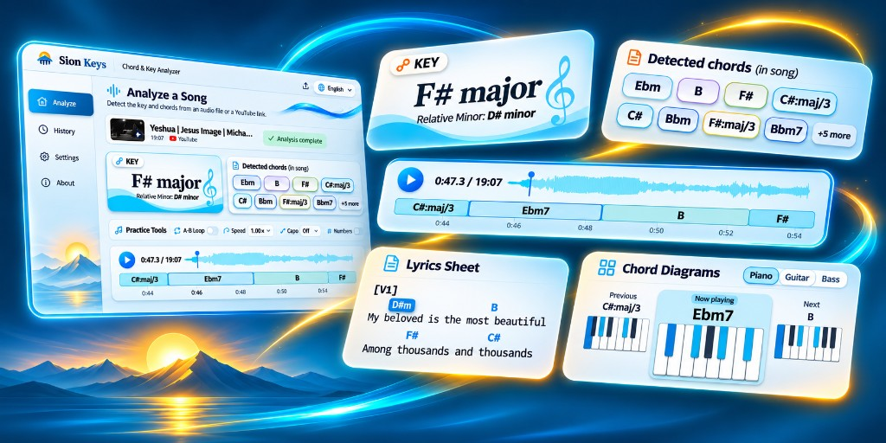

  <picture>
    <source media="(prefers-color-scheme: dark)" srcset="../../assets/sion-keys-wordmark-dark.png">
    
  </picture>

  

<h1 align="center">गाने विश्लेषण करें। कॉर्ड खोजें। सीखें। बजाएँ।</h1>

  <a href="../../README.md">English</a> · <a href="README.bg.md">Български</a> · <a href="README.he.md">עברית</a> · <a href="README.tr.md">Türkçe</a> · <a href="README.es.md">Español</a> · <a href="README.fr.md">Français</a> · <a href="README.de.md">Deutsch</a> · <a href="README.pt.md">Português</a> · <a href="README.it.md">Italiano</a> · <a href="README.ru.md">Русский</a> · <a href="README.zh.md">简体中文</a> · <a href="README.ja.md">日本語</a> · <a href="README.ko.md">한국어</a> · <a href="README.ar.md">العربية</a> · <b>हिन्दी</b> · <a href="README.bn.md">বাংলা</a> · <a href="README.id.md">Bahasa Indonesia</a> · <a href="README.ur.md">اردو</a> · <a href="README.vi.md">Tiếng Việt</a> · <a href="README.th.md">ไทย</a> · <a href="README.pl.md">Polski</a> · <a href="README.uk.md">Українська</a> · <a href="README.ro.md">Română</a>

  <b>संगीतकारों, सीखने वालों और आराधना टीमों के लिए कॉर्ड और सुर-विश्लेषक।</b> 
  अपने पसंदीदा गानों के कॉर्ड और सुर खोजें, कॉर्ड-चिह्न के साथ बोल पढ़ें, और पियानो, गिटार व बास के संवादात्मक चित्रों से अभ्यास करें।

  
  
  
  
  
  

   
  <a href="https://github.com/Stefan7kk/sion-keys-source"><b>स्रोत कोड</b></a> · <a href="https://github.com/Stefan7kk/sion-keys-releases/releases">सभी रिलीज़</a>

<table width="100%">
  <tr>
    <td align="center" valign="top" width="25%"> <strong>गानों का विश्लेषण</strong> ऑडियो फ़ाइलों और समर्थित YouTube लिंक में कॉर्ड और सुर खोजें।</td>
    <td align="center" valign="top" width="25%"> <strong>बोल + कॉर्ड</strong> कॉर्ड के साथ बोल पढ़ें और सिंक होने पर प्लेबैक का साथ दें।</td>
    <td align="center" valign="top" width="25%"> <strong>कॉर्ड चित्र</strong> पियानो, गिटार और बास के संवादात्मक चित्र।</td>
    <td align="center" valign="top" width="25%"> <strong>अभ्यास</strong> लूप, गति, ट्रांसपोज़, कैपो और प्रगति के नियंत्रण।</td>
  </tr>
</table>

  

<h2 align="center">23 भाषाओं में उपलब्ध</h2>

Sion Keys 23 इंटरफ़ेस भाषाओं में उपलब्ध है, ताकि दुनिया भर के संगीतकार संगीत को अधिक सहजता से खोज और अभ्यास कर सकें।

English · Български · עברית · Türkçe · Español · Français · Deutsch · Português · Italiano · Русский · 简体中文 · 日本語 · 한국어 · العربية · हिन्दी · বাংলা · Bahasa Indonesia · اردو · Tiếng Việt · ไทย · Polski · Українська · Română

## Sion Keys को जानें

<table>
  <tr>
    <td valign="top"><strong>ऑडियो और YouTube विश्लेषण</strong></td>
    <td>समर्थित ऑडियो फ़ाइलों और YouTube लिंक का विश्लेषण करके सुर और कॉर्ड का अनुमान लगाएँ।</td>
  </tr>
  <tr>
    <td valign="top"><strong>कॉर्ड समयरेखा</strong></td>
    <td>तरंग के साथ पहचाने गए कॉर्ड-परिवर्तन देखें।</td>
  </tr>
  <tr>
    <td valign="top"><strong>बोल-पत्र</strong></td>
    <td>बोल और कॉर्ड-चिह्न पढ़ें। सिंक उपलब्ध होने पर प्लेबैक उनका साथ देता है।</td>
  </tr>
  <tr>
    <td valign="top"><strong>पियानो, गिटार और बास</strong></td>
    <td>कॉर्ड चित्र तथा वर्तमान और अगला कॉर्ड देखें।</td>
  </tr>
  <tr>
    <td valign="top"><strong>अभ्यास उपकरण</strong></td>
    <td>A–B लूप, प्लेबैक गति, ट्रांसपोज़, कैपो और कॉर्ड संख्याएँ।</td>
  </tr>
  <tr>
    <td valign="top"><strong>सभी कॉर्ड / स्वच्छ प्रगति</strong></td>
    <td>विस्तृत कॉर्ड पहचान और प्रगति पर केंद्रित सरल दृश्य में से चुनें।</td>
  </tr>
  <tr>
    <td valign="top"><strong>गानों का इतिहास</strong></td>
    <td>पिछले विश्लेषण फिर खोलें।</td>
  </tr>
  <tr>
    <td valign="top"><strong>व्यक्तिगत रूप</strong></td>
    <td>Ice, Warm, Rich और Dark थीम, बहुभाषी इंटरफ़ेस और व्यावहारिक सेटिंग्स।</td>
  </tr>
</table>

## त्वरित आरंभ

1. [Windows के लिए Sion Keys](https://github.com/Stefan7kk/sion-keys-releases/releases/latest) डाउनलोड करके स्थापित करें। वर्तमान रिलीज़ [v0.1.0](https://github.com/Stefan7kk/sion-keys-releases/releases/tag/v0.1.0) है। [स्थापना मार्गदर्शिका](../../INSTALLATION.md) बताती है कि इंस्टॉलर की जाँच कैसे करें।
2. एक ऑडियो फ़ाइल खोलें या समर्थित YouTube लिंक का उपयोग करें।
3. गाने का विश्लेषण करें।
4. अनुमानित सुर और पहचाने गए कॉर्ड देखें।
5. बोल-पत्र और कॉर्ड चित्रों का साथ दें।
6. लूप, गति, ट्रांसपोज़ और कैपो से अभ्यास करें।

इंस्टॉलर में मुख्य विश्लेषण इंजन है। स्थानीय बोल-लिप्यंतरण वैकल्पिक है और इंस्टॉलर के अंदर नहीं है: उसका अलग सेटअप Whisper मॉडल डाउनलोड करता है। गाने के विश्लेषण के लिए वह आवश्यक नहीं। विवरण [स्थापना मार्गदर्शिका](../../INSTALLATION.md) में हैं।

## खुला स्रोत

Sion Keys के मूल अनुप्रयोग कोड [MIT लाइसेंस](https://github.com/Stefan7kk/sion-keys-source/blob/main/LICENSE) के अंतर्गत सार्वजनिक भंडार [Stefan7kk/sion-keys-source](https://github.com/Stefan7kk/sion-keys-source) में उपलब्ध है।

डेस्कटॉप ऐप Tauri, React और TypeScript से बना है। ऑडियो विश्लेषण Python में है, और मीडिया के लिए FFmpeg का उपयोग होता है।

आप कार्यान्वयन देख सकते हैं, समस्याएँ बता सकते हैं और सुधार दे सकते हैं। साथ दिए गए निर्भरता, चित्र, मॉडल और अन्य तृतीय-पक्ष संसाधन अपनी लाइसेंस रखते हैं। शर्तें [तृतीय-पक्ष सूचनाओं](https://github.com/Stefan7kk/sion-keys-source/blob/main/THIRD_PARTY_LICENSES.md) में हैं।

## योगदान

योगदान [सार्वजनिक स्रोत भंडार](https://github.com/Stefan7kk/sion-keys-source) में होता है।

- त्रुटियाँ बताएँ।
- सुधार सुझाएँ।
- पुल अनुरोध भेजें।
- अनुवाद सुधारें।
- संगीत-विश्लेषण की जाँच में सहायता करें।

दोहराने के चरण और ऐप संस्करण के साथ एक [मुद्दा](https://github.com/Stefan7kk/sion-keys-source/issues) खोलें, या उसी भंडार में पुल अनुरोध भेजें। सार्वजनिक उदाहरण में ऐसा ऑडियो और बोल उपयोग करें जिन्हें साझा करने की आपको अनुमति हो। स्थापित ऐप के प्रश्न इस डाउनलोड भंडार के [सहायता मुद्दों](https://github.com/Stefan7kk/sion-keys-releases/issues) में भी जा सकते हैं।

विश्लेषण परिणामों के बारे में

- सुर और कॉर्ड की पहचान एक अनुमान है।
- बोलों का मिलान और सिंक उपलब्ध डेटा और ऑडियो गुणवत्ता पर निर्भर करता है।
- वैकल्पिक स्थानीय लिप्यंतरण के लिए अतिरिक्त सेटअप चाहिए हो सकता है।
- कुछ रिकॉर्डिंग में ताल अनिश्चित रह सकता है।

## Sion Keys के पीछे की कहानी

Sion Keys संगीत के प्रेम, विश्वास की एक व्यक्तिगत यात्रा, और दूसरों को उनके प्रिय गीत खोजने, समझने और बजाने में मदद करने की इच्छा से बढ़ा।

पूरी कहानी पढ़ें

मेरा नाम Stefan Dimov है। 2020 में यीशु से व्यक्तिगत भेंट के बाद मैं उनका अनुसरण करने लगा।

संगीत को मेरे हृदय में हमेशा एक विशेष स्थान रहा है। मुझे पियानो और अपना Korg Pa अरेंजर बजाना अच्छा लगता है, पर संगीत मुझे जो सबसे बड़ा आनंद देता है, वह यीशु की आराधना करने और परमेश्वर की महिमा करने का अवसर है।

> *“मार्ग और सत्य और जीवन मैं ही हूँ; बिना मेरे द्वारा कोई पिता के पास नहीं आता।”*
>
> [यूहन्ना 14:6, KJV](https://www.bible.com/bible/1/JHN.14.6.KJV)

### Sion Keys क्यों?

**Sion Keys** नाम इब्रानियों 12:22 में वर्णित सिय्योन पर्वत से प्रेरित है, जहाँ पवित्रशास्त्र जीवते परमेश्वर के नगर और स्वर्गीय यरूशलेम की बात करता है।

मैंने यह नाम इसलिए चुना क्योंकि मेरा विश्वास और आराधना का प्रेम इस कार्य के केंद्र में है। मेरे लिए Sion Keys एक संगीत ऐप से बढ़कर है। यह संगीत के वरदान द्वारा दूसरों के साथ कुछ उपयोगी बाँटने का अवसर है।

[इब्रानियों 12:22, KJV](https://www.bible.com/bible/1/HEB.12.22.KJV)

### Sion Keys कैसे शुरू हुआ

मैंने कान से बजाना सीखा, और जानता हूँ कि एक सुंदर गीत सुनकर उसे बजाना चाहना और सही कॉर्ड न पाना कितना कठिन है।

सीखते समय कॉर्ड पहचानने के साधनों ने मुझे वे गीत समझने में सहायता की जिन्हें मैं अकेला नहीं सुलझा पाया। उसी से एक विचार आया: यदि लोगों के लिए कॉर्ड खोजने, सुर समझने और प्रिय गीत सीखने का कोई सरल और अधिक सुलभ मार्ग हो तो?

वही विचार **Sion Keys** बना।

मेरा लक्ष्य एक निःशुल्क कॉर्ड और सुर-विश्लेषक बनाना था, जिससे संगीतकार गीत खोजें, अभ्यास करें और आत्मविश्वास बढ़ाएँ — चाहे वे बिल्कुल नए हों, अनुभवी वादक हों, या आराधना टीम के सदस्य हों।

### Sion Keys के लिए मेरी आशा

मैं आशा करता हूँ कि Sion Keys संगीत सीखना थोड़ा आसान और अधिक आनंददायक बनाए। मैं चाहता हूँ कि लोग कॉर्ड खोजने में कम समय और बजाने, सीखने, रचने और संगीत बाँटने में अधिक समय लगाएँ।

यदि यह ऐप एक व्यक्ति को भी उसका प्रिय गीत सिखाने, संगीतकार के रूप में बढ़ने, या आराधना में अधिक आनंद पाने में सहायता करे, तो इसे बनाना सार्थक रहा।

सबसे बढ़कर, मैं परमेश्वर का धन्यवादी हूँ कि मुझे कुछ ऐसा बनाने का अवसर मिला जो दूसरों को प्रोत्साहित और सहायता कर सकता है।

> *“मसीह हमारे पापों के लिए मरा … और गाड़ा गया, और पवित्रशास्त्र के अनुसार तीसरे दिन जी उठा।”*
>
> [1 कुरिन्थियों 15:3–4, KJV](https://www.bible.com/bible/1/1CO.15.3-4.KJV)

> *“पुनरुत्थान और जीवन मैं ही हूँ। जो मुझ पर विश्वास करता है, वह मरे भी तो जीएगा।”*
>
> [यूहन्ना 11:25, KJV](https://www.bible.com/bible/1/JHN.11.25.KJV)

## सहायता

[नवीनतम रिलीज़](https://github.com/Stefan7kk/sion-keys-releases/releases/latest) · [स्थापना मार्गदर्शिका](../../INSTALLATION.md) · [परिवर्तन सूची](../../CHANGELOG.md) · [सहायता](https://github.com/Stefan7kk/sion-keys-releases/issues) · [लाइसेंस](../../LICENSE)

ऐप और Windows के संस्करण तथा जो हुआ उसका संक्षिप्त वर्णन देकर [सहायता मुद्दा](https://github.com/Stefan7kk/sion-keys-releases/issues) खोलें। निजी रिकॉर्डिंग, बोल और खाता विवरण सार्वजनिक रिपोर्ट में न डालें।

कॉपीराइट © 2026 Stefan Dimov। इंस्टॉलर में [MIT लाइसेंस](../../LICENSE) और साथ दिए गए तृतीय-पक्ष घटकों की सूचनाएँ शामिल हैं।

